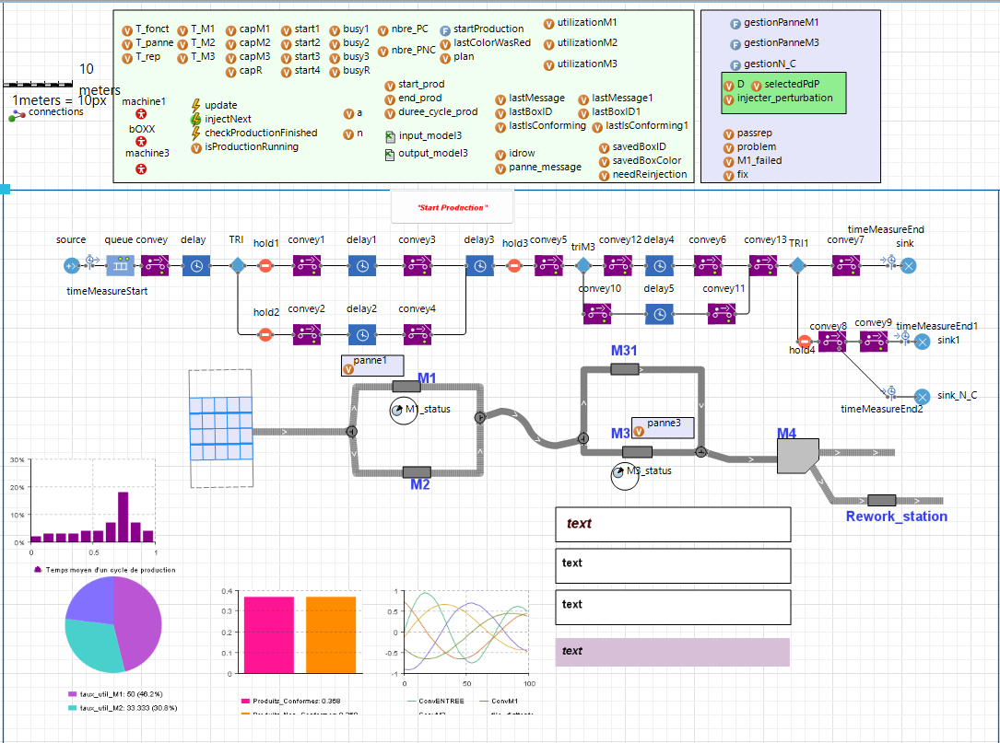
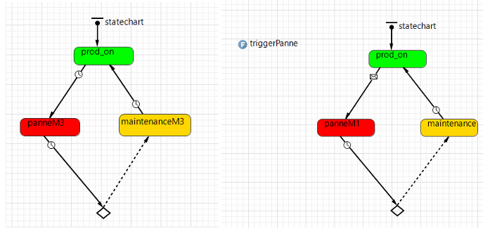
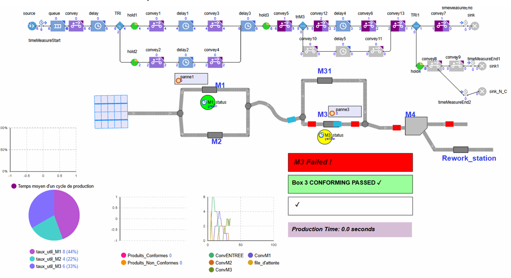

# 🏭 Self-Healing Manufacturing Simulation


An agent-based and discrete-event **AnyLogic simulation** modeling an Industry 4.0 self-healing smart factory system. The model evaluates reactive vs. dynamic agent-driven decision strategies ($D_0, D_1, D_2$) across multiple production plans under sudden machine breakdowns ($M_1, M_3$) and quality defects ($M_4$).

---

## 📌 System Architecture & Operational Routing

The manufacturing line processes two product types (**Red Boxes** and **Blue Boxes**) generated from a primary source according to dynamic operational plans ($Plan_1, Plan_2, Plan_3$):

```text
[Red Box]  ---> M1 (Op oi1) ---> M3 (Op oi3) ---> M4 (Quality Inspection) ---> Conforming (Sink)
                                                                            ---> Non-Conforming (Rework / Re-injection)

[Blue Box] ---> M2 (Op oi2) ---> M3 (Op oi3) ---> M4 (Quality Inspection) ---> Conforming (Sink)
```

### Entity Specifications

| Entity | Identifier | Function / Role | Parameters & Logic |
|---|---|---|---|
| **Source** | `source` | Emits Red Box & Blue Box entities | Dynamic schedule driven by `input_model3.xlsx` |
| **Machine 1** | `M1` | Primary operation ($oi1$) for **Red Boxes** | Capacity $capM1$, Failure statechart (`panneM1`) |
| **Machine 2** | `M2` | Primary operation ($oi2$) for **Blue Boxes** | Capacity $capM2$, Backup route for M1 |
| **Machine 3** | `M3` | Common operation ($oi3$) for all products | Line bottleneck ($capM3$), Failure statechart (`panneM3`) |
| **Machine 31** | `M31` | Parallel backup machine for M3 | Activated dynamically under Decision $D_2$ |
| **Quality Control** | `M4` | Quality inspection & defect detection | Rejection probability `randomTrue(prob)` |
| **Rework Station** | `Rework_station` | Defect repair & item recovery | Active under Decision $D_1$ |

---

## 🔄 Data Pipeline & Excel Integration

The simulation model operates as a fully automated, data-driven pipeline:

```text
[ input_model3.xlsx ]  --->  ( AnyLogic Simulation Engine )  --->  [ output_model3.xlsx ]
 Config & Parameters         Dynamic Processing & Routing        KPI Analytics & Exports
```

1. **Input Configuration (`input_model3.xlsx`):** Dynamically feeds arrival schedules, product type ratios (Red/Blue), operational processing times ($oi1, oi2, oi3$), machine capacities, and failure probability parameters into AnyLogic at runtime.
2. **Output Analytics (`output_model3.xlsx`):** The simulation engine logs real-time operational timestamps ($t_{ij}, c_{ij}$) for every entity and automatically computes itemized product-level and plan-level performance indicators.

---

## ⚡ Disturbance vs. Self-Healing Decision Matrix

The system evaluates resilience and recovery logic across three disturbance types and three decision levels:

| Disturbance Type | Decision $D_0$ (Inaction) | Decision $D_1$ (Moderate Corrective) | Decision $D_2$ (Advanced / Structural) |
|---|---|---|---|
| **$M_1$ Breakdown** | No action; Red Boxes queue up until maintenance completes. | Redirect Red Boxes dynamically to Machine $M_2$. | Redirect Red Boxes to $M_2$ **+** Boost $M_2$ processing capacity. |
| **$M_3$ Breakdown** | No action; entire line halts at bottleneck. | Increase post-maintenance execution capacity of $M_3$. | Switch flow dynamically to parallel Machine $M_{31}$. |
| **Quality Defect ($M_4$)** | Reject items directly to non-conforming sink (`sink_N_C`). | Route defective items to `Rework_station` for repair. | Purge defectives and re-inject them from primary source. |

---

## 📊 Performance Benchmarks & Results

### 1. Baseline Performance (No Disturbances)

| Plan | Products Count | Utilization $M_1$ (%) | Utilization $M_2$ (%) | Utilization $M_3$ (%) | Makespan $C_{max}$ (s) | Delayed Products |
|---|---|---|---|---|---|---|
| **Plan 1** | 5 | 15.19% | 8.10% | 15.36% | **39.50 s** | 0 |
| **Plan 2** | 6 | 17.51% | 8.75% | 26.26% | **45.70 s** | 0 |
| **Plan 3** | 8 | 25.78% | 18.26% | 20.44% | **46.55 s** | 0 |

---

### 2. Decision Impact Comparison Under Perturbations

* **Machine $M_1$ Failure:**
  * $D_0$ causes line blockage: $C_{max}$ surges to **60.50 s** (+37.8%) with 3 delayed items.
  * $D_1$ (Dynamic reroute to $M_2$) restores flow: reduces cumulative delay by **63.4%** and stabilizes $C_{max}$ at **47.30 s**.
  * $D_2$ yields negligible gain ($C_{max} = 46.40\text{ s}$) relative to the cost of boosting $M_2$ capacity.

* **Machine $M_3$ Failure (Bottleneck):**
  * $D_0$ & $D_1$ show similar delays (3 products) due to bottleneck inertia.
  * $D_2$ (Switching to parallel machine $M_{31}$) causes transfer delays and conveyor congestion (+484% explosion in total delay sum, $C_{max} = 57.10\text{ s}$).

* **Quality Non-Conformity at $M_4$:**
  * $D_0$ finishes quickly ($C_{max} = 50.10\text{ s}$) but suffers a **25% scrap loss**.
  * $D_1$ (Rework Station) provides the **optimal industrial compromise**: recovers 100% of defectives with an acceptable $C_{max}$ of **54.30 s**.
  * $D_2$ (Source Re-injection) guarantees zero quality-defect penalties but **saturates the line**, exploding $C_{max}$ to **136.30 s** (+172%).

---

## 📐 Key Performance Indicators (KPIs) Dictionary

Operational tracking and automated calculations recorded in `output_model3.xlsx` follow these metrics:

### 1. Operational Timestamps
* **$t_{ij}$ / $c_{ij}$:** Start time ($t$) and completion time ($c$) for operation $j$ on product $i$ ($j \in \{1, 2, 3\}$).
* **$t_{ir}$ / $c_{ir}$:** Start and completion timestamps for the rework station operation ($oir$).

### 2. Product-Level Metrics (Indicateurs / Produits)

| Metric | Formula / Variable | Description |
|---|---|---|
| **`KPI1 (Ui)`** | $U_i \in \{0, 1\}$ | **Tardiness Flag:** Binary indicator ($1$ if product $i$ is delayed past due date, $0$ otherwise). |
| **`KPI2 (Ti)`** | $T_i = \max(0, C_i - d_i)$ | **Product Delay:** Individual delay time beyond scheduled due date $d_i$. |
| **`KPI3 (Ci)`** | $C_i$ | **Completion Time:** Exact timestamp when product $i$ exits the line. |
| **`KPI4 (STi)`** | $ST_i = C_i - t_{i1}$ | **System Flow Time:** Total duration product $i$ spent in the factory. |
| **`NCi`** | $NC_i \in \{0, 1\}$ | **Non-Conformity Flag:** Binary defect indicator assigned at $M_4$ inspection. |

### 3. Plan-Level Aggregate Metrics (Indicateurs / Plan)

| Metric | Formula / Variable | Description |
|---|---|---|
| **`KPI5`** | $\sum U_i$ | **Delayed Products Count:** Total number of late items in the batch. |
| **`KPI6`** | $\sum T_i$ | **Cumulative Delay Sum:** Total combined tardiness across all products (seconds). |
| **`KPI7`** | $C_{max} = \max(C_i)$ | **Makespan:** Total execution time to process the entire production plan. |
| **`KPI8`** | $\frac{\text{Defective Items}}{\text{Total Items}} \times 100$ | **Scrap / Rejection Rate (%):** Percentage of non-conforming items produced. |
| **`KPI9`** | Count of $NC_i = 1$ | **Total Non-Conforming Products:** Count of defective items detected at $M_4$. |

---

## 📸 System Architecture & Visuals

### 1. System Architecture & Process Flow Canvas


### 2. Failure Statecharts & Disturbance Logic


### 3. Live Simulation Runtime & Real-Time Monitoring


---

## 🛠️ How to Run

1. Open **AnyLogic** (University or Professional Edition).
2. Open `ModelTP3.alp`.
3. Ensure `input_model3.xlsx` is present in the root directory for plan parameters.
4. Run the simulation experiment:
   * Select the production plan (`selectedPdP`: 1, 2, or 3).
   * Enable perturbation injection (`injecter_perturbation`: `true`/`false`).
   * Select Decision Level (`D`: 0, 1, or 2).
5. Simulation output metrics are logged directly to `output_model3.xlsx`.
